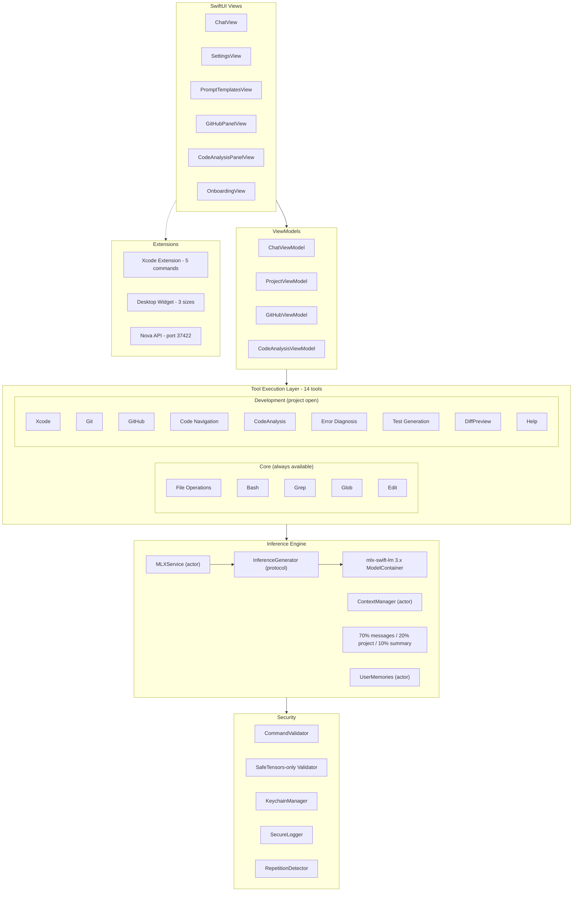
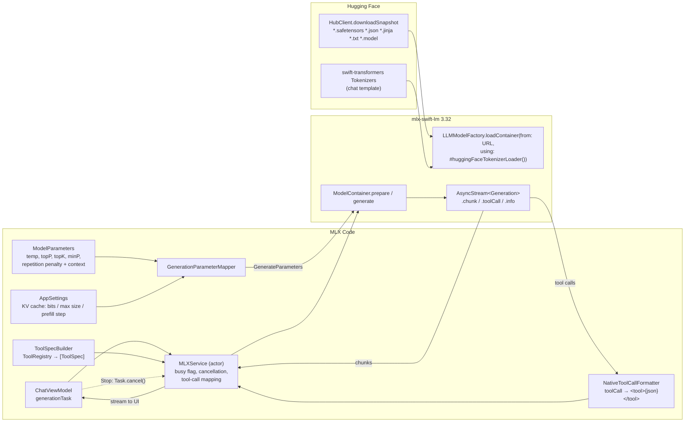
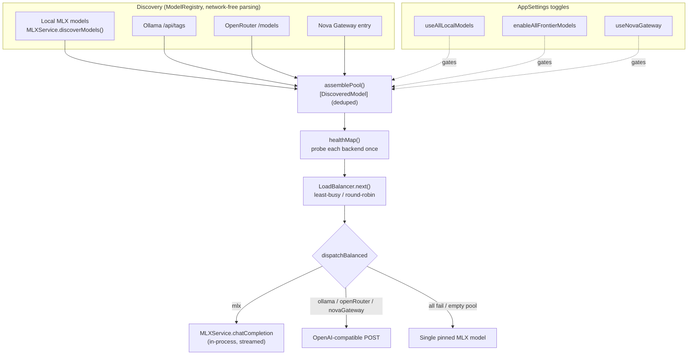

# MLX Code


A local AI coding assistant for macOS, powered by Apple MLX. No cloud. No subscriptions. No data leaving your machine.

MLX Code runs language models directly on Apple Silicon using [mlx-swift](https://github.com/ml-explore/mlx-swift) and [mlx-swift-lm](https://github.com/ml-explore/mlx-swift-lm) 3.x. It provides a chat interface with 14 built-in tools that can read files, search code, run shell commands, build Xcode projects, manage Git repos, and interact with GitHub -- all driven by a local model running on your GPU.

Written by Jordan Koch.

---

## Architecture



### Data Flow

```mermaid
sequenceDiagram
    participant User
    participant ChatView
    participant ChatViewModel
    participant ToolRegistry
    participant MLXService
    participant ContextManager

    User->>ChatView: Type message or slash command
    ChatView->>ChatViewModel: Send message
    ChatViewModel->>ContextManager: Assemble context (budget-aware)
    ContextManager-->>ChatViewModel: System prompt + history + project context
    ChatViewModel->>ToolRegistry: Build native ToolSpecs
    ChatViewModel->>MLXService: chatCompletion(messages, tools) in a cancellable Task
    MLXService-->>ChatViewModel: Stream chunks + native tool calls (rendered as <tool> blocks)
    ChatViewModel->>ChatViewModel: Extract tool calls (native or text fallback)
    ChatViewModel->>ToolRegistry: Execute approved tools
    ToolRegistry-->>ChatViewModel: Tool results
    ChatViewModel->>MLXService: Continue generation with results
    MLXService-->>ChatView: Final response
    User-->>ChatViewModel: Stop (cancels the Task; MLXService ends the token stream)
```

### Inference Path (mlx-swift-lm 3.x)



---

## Features

### Native On-Device Inference (mlx-swift-lm 3.x)

- **Real Stop** -- Stop cancels the generation task; token generation ends inside mlx-swift-lm and the next request starts immediately. The partial answer is kept.
- **Native tool calling** -- the tool registry is sent to the model's chat template as `ToolSpec`s, and `Generation.toolCall` events (Qwen, Llama, Mistral, Gemma, Harmony and more formats parsed by mlx-swift-lm) feed the existing approval flow -- several calls per turn are supported. The `<tool>…</tool>` text protocol remains as a fallback.
- **KV-cache controls** -- Settings → Model: KV quantization (none / 8-bit / 4-bit), max KV size (rotating cache) and prefill step size.
- **Full sampling controls** -- temperature, top-p, top-k, min-p, repetition penalty (default 1.1) and repetition context size are all passed to the sampler.
- **Complete downloads** -- chat templates (`*.jinja`), BPE merges (`*.txt`) and SentencePiece models (`*.model`) are fetched along with weights and configs.
- **Context detection** -- the context window is read from `config.json`, including nested `text_config` (Qwen3.5/3.6, Gemma 4, Devstral 2).

### 14 Built-in Tools

| Tool | Purpose | Tier |
|---|---|---|
| **File Operations** | Read, write, edit, list, delete files | Core |
| **Bash** | Run shell commands | Core |
| **Grep** | Search file contents with regex | Core |
| **Glob** | Find files by pattern | Core |
| **Edit** | Apply targeted file edits | Core |
| **Xcode** | Build, test, clean, archive, deploy | Dev |
| **Git** | Status, diff, commit, branch, log, push, pull | Dev |
| **GitHub** | Issues, PRs, branches, credential scanning | Dev |
| **Code Navigation** | Jump to definitions, find symbols | Dev |
| **Code Analysis** | Metrics, dependencies, lint | Dev |
| **Error Diagnosis** | Analyze and explain build errors | Dev |
| **Test Generation** | Create unit tests from source files | Dev |
| **Diff Preview** | Show before/after file changes | Dev |
| **Help** | List available commands and usage | Dev |

Read-only tools auto-approve. Write and execute tools require confirmation.

### Slash Commands

```
/commit    /review    /test      /docs
/refactor  /explain   /optimize  /fix
/search    /plan      /help      /clear
```

### Prompt Engineering Toolkit

15 curated prompt templates across 9 categories (Review, Debug, Generate, Refactor, Test, Document, Security, Performance, Deploy). Browse templates, fill variables, preview rendered prompts, and send -- all in-app.

### Xcode Source Editor Extension

Select code in Xcode and invoke from **Editor > MLX Code**:

- Explain Selection
- Refactor Selection
- Generate Tests
- Fix Issues
- Ask MLX Code (opens with code pre-loaded)

Communicates via shared App Group container and `mlxcode://` URL scheme.

### Desktop Widget (WidgetKit)

Three sizes (small, medium, large) showing model status, token speed, memory usage, and quick-action deep links.

### GitHub Integration

View and create issues, list and create PRs, manage branches, scan for exposed credentials before pushing.

### User Memories

50+ built-in coding standards across 8 categories injected into the system prompt at runtime. Custom memories stored locally.

### Context Management

- Token budgeting: 70% messages, 20% project context, 10% summary
- Automatic message compaction when context fills up
- Real-time context window usage bar synced to model size
- Project context auto-included when a workspace is open

### Syntax Highlighting

Code blocks render with highlighting for Swift, Python, JavaScript, TypeScript, Bash, JSON, and Objective-C.

---

## Models

Uses [mlx-community](https://huggingface.co/mlx-community) models from Hugging Face, quantized for Apple Silicon.

| Model | Size | Context | Best for |
|---|---|---|---|
| **Qwen3.5 9B** (default) | ~5 GB | 256K | General coding, native tool calling (16 GB+ RAM) |
| Qwen3-Coder 30B-A3B (MoE) | ~17 GB | 256K | Agentic coding (32 GB+ RAM) |
| Devstral Small 2 24B | ~14 GB | 384K | Software-engineering agent tasks (32 GB+ RAM) |
| Qwen3.6 35B-A3B (MoE) | ~20 GB | 256K | High quality at MoE speed (32 GB+ RAM) |
| Qwen3.6 27B | ~16 GB | 256K | Best quality, slower (32 GB+ RAM) |
| Gemma 4 E4B | ~4 GB | 128K | Efficient general model |
| Qwen3.5 2B | ~1.5 GB | 256K | Fast edits on 8 GB Macs |
| Qwen 2.5 7B (legacy) | ~4 GB | 32K | Kept for existing installs |

All entries are `mlx-community` 4-bit repos whose architectures are supported by mlx-swift-lm 3.32. Long contexts need a lot of memory -- use the KV-cache settings to cap or quantize it.

Models download automatically via the native Swift Hugging Face client (`HubClient`). Custom models from any mlx-community repository are supported. All models must be **SafeTensors** format -- PyTorch pickle files are rejected.

---

## Multi-model load balancing

By default MLX Code talks to a single pinned MLX model. Optionally, it can spread each chat across **every** model available to the machine -- all installed local models (native MLX + a local Ollama, if present), all frontier models via an OpenRouter key, and an optional Nova Gateway -- health-gated and load-balanced. This is off by default; when every toggle is off, behavior is exactly as before.

Three independent toggles live in **Settings → Balancer**:

| Toggle | Adds to the pool | Requires |
|---|---|---|
| **All local models** | Every installed SafeTensors MLX model + any models served by a local Ollama | Nothing (Ollama optional) |
| **All frontier models** | Frontier models via OpenRouter | An OpenRouter API key (stored in the Keychain) |
| **Nova Gateway** | One entry that routes to Nova's OpenAI-compatible gateway | Nothing -- **entirely optional** |

**Nova is never a hard requirement.** With zero Nova present the balancer still works over local MLX/Ollama models and/or OpenRouter. The Nova Gateway is just one optional entry: if its health probe (`GET <url>/v1/models`) fails, that entry is marked unavailable and every other model keeps working.

Selection is **health-gated then balanced**: each distinct backend is probed once (MLX = a model is loaded; Ollama = `/api/tags` 200; OpenRouter = a key is present; Nova = `/v1/models` 200), unhealthy models are dropped, and the `LoadBalancer` picks the next model by **least-busy** (fewest in-flight requests) or **round-robin**. A model that fails mid-request is removed and the next healthy one is tried; if the pool is empty it falls back cleanly to the single pinned MLX model.



Implemented by `ModelRegistry` / `LoadBalancer` / `OpenRouterProvider` / `KeychainStore` (the pure, network-free, unit-tested pieces) wired together by `LLMBalancer` and invoked from `ChatViewModel`. Covered by the network-free `LoadBalancerTests` suite.

---

## Nova API Server

Local HTTP API on port **37422** (loopback only).

| Method | Endpoint | Description |
|---|---|---|
| GET | /api/status | App status, model state, uptime |
| GET | /api/ping | Health check |
| GET | /api/conversations | List all conversations |
| POST | /api/chat | Send message, get response |
| GET | /api/model | Current model info |
| POST | /api/model/load | Load a model |
| GET | /api/metrics | Performance metrics (tokens/sec, memory) |
| POST | /api/cancel | Cancel current generation |
| GET | /api/prompts | List prompt templates |
| POST | /api/prompts/render | Render template with variables |

---

## Requirements

- **macOS 14.0** (Sonoma) or later
- **Apple Silicon** (M1, M2, M3, M4)
- **8 GB RAM** minimum (16 GB recommended)
- **No Python required** -- inference and downloads are pure Swift
- **Xcode 26+** -- only needed to build from source (mlx-swift-lm 3.x uses swift-tools 6.2 and Swift macros)

## Installation

### From DMG (recommended for most users)

1. Download the latest `.dmg` from [Releases](https://github.com/kochj23/MLXCode/releases).
2. Open it and drag **MLX Code** into your **Applications** folder.
3. Launch it from Applications and download a model from Settings. That's it — no Xcode, no toolchains, nothing else to install.

> **See "MLX Code can't be opened because the developer cannot be verified"?**
> That means you have a build that isn't yet Developer-ID-signed **and** notarized. To open it anyway:
> - **macOS 14 and earlier:** Control-click (right-click) the app → **Open** → **Open**.
> - **macOS 15 (Sequoia) / 26 and later:** double-click it, dismiss the dialog, then open **System Settings → Privacy & Security**, scroll down, and click **Open Anyway**.
> - Or from Terminal: `xattr -dr com.apple.quarantine "/Applications/MLX Code.app"`
>
> **Notarized releases open with no prompt at all** — maintainers, see [RELEASE.md](RELEASE.md).

### From Source

Requires **Xcode 26 or later**. Because the app bundles **MLX** for on-device LLM inference, the build
compiles Metal GPU shaders, which needs Apple's **Metal Toolchain** — a component recent Xcode versions
no longer ship by default. Install it once:

```bash
xcodebuild -downloadComponent MetalToolchain
# (or in Xcode: Settings → Components → Metal Toolchain → Get)
```

Then build:

```bash
git clone git@github.com:kochj23/MLXCode.git
cd MLXCode
open "MLX Code.xcodeproj"   # Xcode resolves Swift packages on first open (mlx-swift, mlx-swift-lm, swift-huggingface, swift-transformers)
# Build & run: Cmd+R (Xcode 26+, macOS 14.0+ target). Approve the MLXHuggingFace macros when Xcode asks.
```

Command-line builds must pass `-skipMacroValidation` (mlx-swift-lm's `#huggingFaceTokenizerLoader()` is a Swift macro).
Pinned dependency versions are committed in `MLX Code.xcodeproj/project.xcworkspace/xcshareddata/swiftpm/Package.resolved`.

> Skipping the Metal Toolchain step produces a wall of `CompileMetalFile … cannot execute tool 'metal'
> due to missing Metal Toolchain` errors from the `mlx-swift` dependency. That's the missing component,
> not a problem with the project.

### Enabling the Xcode Extension

1. System Settings > Privacy & Security > Extensions > Xcode Source Editor
2. Enable **MLX Code**
3. Restart Xcode
4. Select code, then Editor > MLX Code

---

## Security

- **100% local inference** -- no prompts or responses leave your machine
- **CommandValidator** blocks dangerous shell patterns (rm -rf, fork bombs, sudo, eval, curl|sh)
- **ModelSecurityValidator** enforces SafeTensors-only, verifies hashes via CryptoKit
- **KeychainManager** stores API keys in macOS Keychain
- **SecureLogger** with category-based logging, no PII in logs
- **RepetitionDetector** breaks inference loops automatically
- No telemetry, analytics, or crash reporting

---

## What It Does Not Do

- No web browsing or URL fetching
- No image/video/audio generation
- Small model constraints (3-14B parameters) mean imperfect multi-step reasoning
- Tool calling from local models is sometimes malformed (JSON auto-repair helps)
- Xcode extension opens a separate window rather than responding inline

---

## Test Suite

574 tests across 28 test files covering models, services, security, context budgeting, build parsing, Keychain, tool registry, JSON repair, prompt templates, source-level security scanning, and the inference engine (parameter mapping, Stop/cancellation, native tool calls, download patterns, catalog, context parsing) via a mock generator -- no model download needed.

```bash
xcodebuild -project "MLX Code.xcodeproj" -scheme "MLX Code" \
  -destination "platform=macOS" -skipMacroValidation test
```

Optional real-model integration test (skipped by default):

```bash
TEST_RUNNER_MLXCODE_INTEGRATION=1 TEST_RUNNER_MLXCODE_MODEL_PATH=/path/to/mlx-model \
  xcodebuild -project "MLX Code.xcodeproj" -scheme "MLX Code" -destination "platform=macOS" \
  -skipMacroValidation -only-testing:"MLX Code Tests/MLXServiceTests/testIntegrationLoadAndStreamRealModel" test
```

---

## Version History

| Version | Date | Highlights |
|---|---|---|
| 6.4.0 | 2026-11 (unreleased) | mlx-swift-lm 3.32 / mlx-swift 0.32.3, real Stop, native tool calling, KV-cache settings, min-p, model catalog refresh (Qwen3.5/3.6, Qwen3-Coder, Gemma 4, Devstral 2), complete tokenizer downloads, dead Python scripts removed; multi-model load balancer (local + frontier + optional Nova) |
| 6.3.0 | 2026-03-04 | Native model downloads, tool-call reliability, Xcode Source Editor Extension |
| 6.1.0 | 2026-02-26 | Security hardening and code-quality audit |
| 5.0.0 | 2026-02-19 | Focused rewrite: removed media generation, RAG and auxiliary panels |
| 4.0.0 | 2026-02-19 | Native mlx-swift inference |
| 1.0.0 | 2025-11-18 | Initial release |

See [CHANGELOG.md](CHANGELOG.md) for details.

---

## License

MIT License -- Copyright 2025-2026 Jordan Koch

See [LICENSE](LICENSE) for the full text.

---

Written by Jordan Koch ([@kochj23](https://github.com/kochj23))
